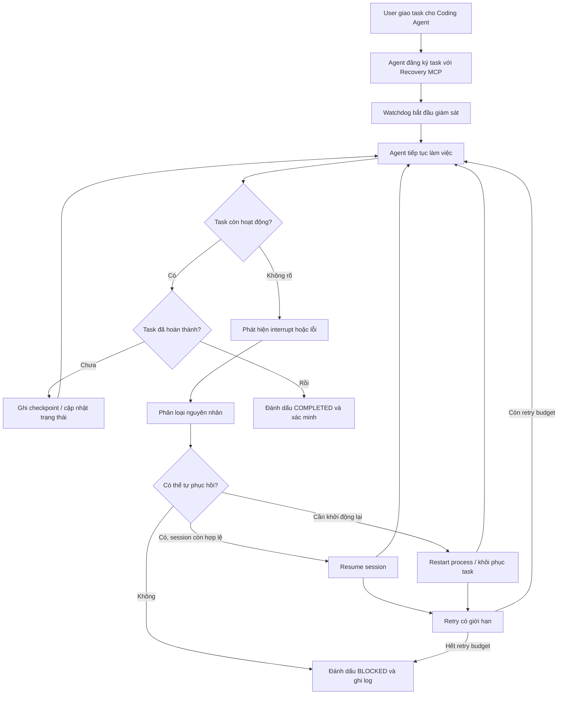

Workflow cần lưu ý
1. Đăng ký task: agent gửi task ID, loại agent, session ID nếu có và working directory.
2. Giám sát: Watchdog theo dõi trạng thái process, heartbeat, session và thời gian không có tiến triển.
3. Phát hiện: nếu có dấu hiệu gián đoạn, Watchdog kiểm tra trạng thái thực tế trước khi hành động.
4. Phục hồi: ưu tiên tiếp tục session hiện có; chỉ restart khi cần thiết.
5. Tiếp tục: gửi yêu cầu tương đương Continue, hoặc tạo session mới từ checkpoint nếu không thể phục hồi session cũ.
6. Xác minh: xác nhận task tiếp tục hoạt động, không khởi chạy trùng và không đánh dấu hoàn thành sai.
7. Lặp lại: tiếp tục theo dõi đến khi task hoàn thành hoặc bị chặn bởi lỗi không thể tự khắc phục.
Lưu ý: không phải cứ không có heartbeat là agent đã chết. Một agent có thể đang chạy test hoặc thực hiện tác vụ lâu. Watchdog cần phân biệt RUNNING, IDLE, INTERRUPTED và UNKNOWN để tránh resume nhầm.